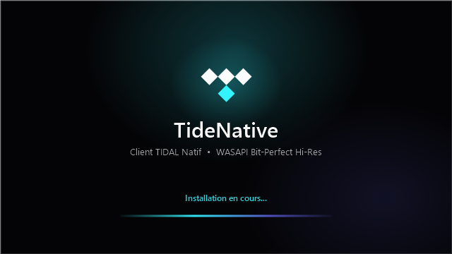

<p align="center">
  
</p>

<h1 align="center">TideNative</h1>

<p align="center">
  Client desktop TIDAL natif pour Windows, avec moteur audio Rust WASAPI Exclusif Bit-Perfect et interface fluide OLED 120 Hz.
</p>

<p align="center">
  <a href="https://github.com/Leboxis/TideNative/releases/latest">
    
  </a>
  
  
  <a href="LICENSE">
    
  </a>
</p>

---

## Installation (Windows 10 / 11 x64)

1. Téléchargez **`TideNative-win-Setup.exe`** depuis la page [**Releases**](https://github.com/Leboxis/TideNative/releases/latest).
2. Double-cliquez sur le fichier : l'installeur Velopack installe l'application dans `%LOCALAPPDATA%` sans droits administrateur, crée les raccourcis (Bureau et Menu Démarrer) et ouvre TideNative automatiquement.
3. Connectez votre compte TIDAL au premier lancement.

Une archive sans installation (`TideNative-win-Portable.zip`) est aussi disponible sur la même page.

> **Note Windows SmartScreen :** l'exécutable n'étant pas signé par un certificat commercial, Windows peut afficher un avertissement au premier lancement. Cliquez sur **Informations complémentaires** puis **Exécuter quand même**.

### Mises à jour automatiques

Lorsque TideNative est installé via `TideNative-win-Setup.exe`, l'application vérifie discrètement les nouvelles versions sur GitHub Releases au démarrage. Les mises à jour téléchargent uniquement les différences (delta) et s'appliquent en un clic depuis la notification ou depuis **Paramètres → Mises à jour automatiques**.

---

## Fonctionnalités

### Audio Hi-Res & Bit-Perfect
- Sortie matérielle directe **WASAPI Exclusif** vers votre DAC (contournement du mixeur Windows et de son rééchantillonnage), avec repli automatique en mode partagé si le périphérique est occupé.
- Lecture FLAC Hi-Res jusqu'à **24-bit / 192 kHz** (`MAX`), FLAC CD 16-bit / 44,1 kHz (`HIGH`) et AAC.
- Enchaînement **Gapless** sans coupure, verrouillage du volume à 100 % en mode Bit-Perfect et normalisation ReplayGain (piste, album ou désactivée).
- Panneau de diagnostic matériel en temps réel dans les paramètres (codec actif, PCM source, conteneur DAC, mode WASAPI).

### Navigation TIDAL & bibliothèque
- Accueil personnalisé (Daily Mix, Discovery, New Arrivals) et vue Explorer avec recherche hybride et suggestions instantanées.
- Cache local SQLite FTS5 pour consulter et filtrer rapidement vos favoris, albums, artistes et playlists.
- Gestion complète des playlists (création, édition, réorganisation, duplication, import/export), paroles synchronisées, crédits détaillés et radio automatique en fin de file.
- Filtres optionnels pour les contenus explicites et les pistes générées par IA.

### Interface & intégration Windows
- Fenêtre sombre OLED (`#040406`) sans flash blanc au démarrage, fond ambiant extrait de la pochette en cours et visualisation audio temps réel.
- Mode compact flottant (*Always-on-top*), choix de la typographie (Inter, Season Mix, DM Sans, Plus Jakarta Sans) et raccourcis clavier.
- Intégration native **Windows SMTC** (touches multimédias clavier et panneau système), icône dans la zone de notification pour garder la musique en arrière-plan, scrobbling **Last.fm** et statistiques d'écoute locales.

---

## Détails techniques

<details>
<summary><strong>Architecture du projet (Rust + Tauri v2 + React 19)</strong></summary>

TideNative sépare strictement le moteur audio/métier de l'interface graphique :

| Couche | Emplacement | Rôle |
| --- | --- | --- |
| Moteur audio & décodeur | `crates/audio-wasapi`, `crates/decoder`, `crates/player` | Négociation WASAPI Exclusif/Partagé, décodage FLAC/AAC, lecture Gapless et ReplayGain |
| API, auth & streaming TIDAL | `crates/tidal-auth`, `crates/tidal-api`, `crates/tidal-stream` | Session TIDAL, catalogue, manifests MPEG-DASH et préchargement parallèle à faible latence |
| Stockage & intégration Windows | `crates/cache`, `crates/platform-win` | Base locale SQLite FTS5, cache pochettes + palettes, DWM Windows 11, SMTC et Tray |
| Orchestrateur headless | `crates/app-engine`, `crates/core` | File d'attente, filtres, Last.fm, statistiques et événements moteur |
| Shell desktop | `app-tauri` | Fenêtre Tauri v2, protocole `tidal-cover://`, télémétrie binaire 44 o, updater Velopack et bindings `tauri-specta` |
| Interface 120 Hz | `ui/` | Vite 6, React 19, TypeScript, Tailwind CSS v4, Radix UI, Motion, Zustand, TanStack Virtual |

</details>

<details>
<summary><strong>Compiler et packager depuis les sources</strong></summary>

### Prérequis
- Windows 10/11 x64
- Rust (`stable-x86_64-pc-windows-gnu`, configuré dans `rust-toolchain.toml`)
- Node.js + `pnpm`
- Runtime .NET 8 (utilisé pour exécuter `vpk` lors du packaging Velopack)

### Commandes

```powershell
# Installer les dépendances frontend
pnpm --dir ui install

# Lancer les tests
cargo test -p tidenative-tauri --test ipc_tests
pnpm --dir ui test -- --run

# Construire l'exécutable release et l'installateur Velopack
powershell -NoProfile -ExecutionPolicy Bypass -File installer/Build-Release-Dist.ps1
```

L'installateur est généré dans `dist/TideNative-Setup.exe` et les fichiers de release (`releases.win.json`, `.nupkg`, archive portable) dans `dist/velopack-releases/`.

Pour tester les mises à jour automatiques contre une source personnalisée (URL HTTPS ou dossier local), définissez la variable d'environnement `TIDENATIVE_UPDATE_URL`.

</details>

---

## Licence

Distribué sous licence [MIT](LICENSE).  
TideNative est un client indépendant non affilié à TIDAL Music AS. Un abonnement TIDAL actif est requis.
